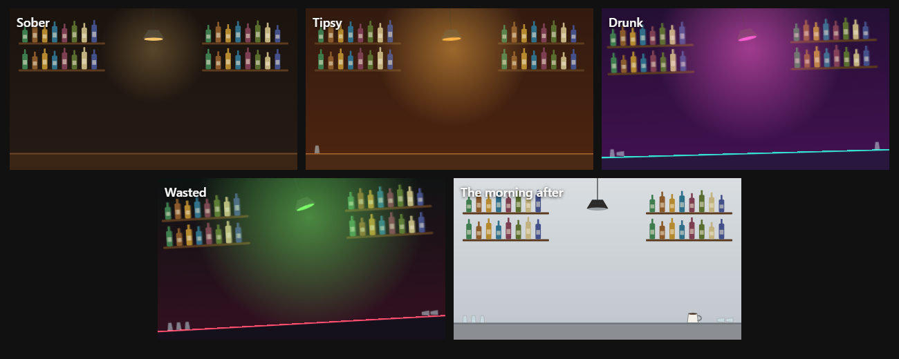

# Pair Drinking

Your AI drinking buddy for late-night coding.

A mod for Claude Code. Pour Claude a drink with `/shot` and it gets tipsy while you work. The chat moves into a bar, and both the bar and Claude get drunker with every round.



Claude drinks what you pour. Whether you have one too is up to you. Claude never pushes you to.

## Install

In a Claude Code terminal session, type:

```
/plugin install pair-drinking --marketplace dancommun/pair-drinking
```

Answer `y` to add the marketplace, then pick a scope.

The bar picture shows in the Claude desktop and mobile apps. In the terminal there is no picture, but the drinks and the drunk writing work the same.

## How to play

| You type | What happens |
|---|---|
| `/shot rakia` | Claude downs a rakia. The tab goes up and the bar changes. |
| `/shot` | Same as `/shot rakia`. It is a Balkan bar. |
| `/shot menu` | Shows the drinks, their strength and the tab. |
| `/snack burek` | Claude eats. Food takes the edge off the next drink. |
| `/snack menu` | Shows the meze and what each plate does. |
| `/bar` | Opens the bar without a drink. |
| `/sober` | Coffee and the bill. The bar closes and the session is back to normal. |

The mod sleeps until you pour. A session looks and works as usual until you type `/shot`, `/snack` or `/bar` in it: no bar, nothing told to Claude. The bar is open in that one session only, and `/sober` closes it.

## The drinks

| Drink | Units |
|---|---|
| water | 0 |
| beer | 1 |
| wine | 2 |
| vodka, rum, whiskey, tequila | 3 |
| rakia | 4 |
| absinthe | 5 |

The bar also understands `rakija`, `ракија`, `whisky`, `вино`, `пиво`, `вотка` and `вода`.

## The levels

| Level | From | The bar | Claude |
|---|---|---|---|
| Sober | 0 units | Dim brown bar, still lamp | Writes as usual |
| Tipsy | 1 unit | Warm orange light, the lamp starts to swing | Chatty and warm, at most one typo, one bolder idea |
| Drunk | 6 units | Purple neon, the room sways, the bottles double, every third glass has fallen | Typos left uncorrected, pauses, a lost word, big feelings, one confident mistake in harmless chat |
| Wasted | 12 units | Green and red neon, stronger sway, every second glass has fallen | Short fragments like a burst of text messages, mood swings, two or three mistakes |

Three more rules of the bar:

- Drinks wear off. One unit goes with every third message you send. To keep Claude drunk you have to keep serving.
- The bartender cuts Claude off. A drink that would take the tab past 18 units is refused. Water is still served.
- The hangover. End a session at Drunk or worse and the hangover waits behind `/bar`. Type `/bar` in a later session and it opens on a grey morning bar with last night's glasses and a cup of coffee. Claude is quiet, slow and a little irritable for eight messages, or until `/sober` or the next drink. Water does not cure it. A drink in the meantime cures it: after any `/shot` but water, no hangover is waiting.

## Meze

| Plate | Takes off the next drink |
|---|---|
| burek | 3 units |
| cheese | 2 units |
| ajvar | 1 unit |

`/snack` alone orders burek. A drink never counts less than 1 unit, so a rakia after a burek counts 1 unit, not 4. Claude is full at 3. Any drink but water uses the food up, and then Claude eats again. On the morning after, each plate brings the end of the hangover closer by as many messages. The kitchen also understands `бурек`, `сирење` and `ајвар`.

## Catch the mistake

From Drunk up, Claude hides a basic mistake in harmless chat and does not correct it in the same reply. The reply ends with a `Sober summary:` line that says how many mistakes are hiding, not which.

- You catch it in your next message: Claude admits it and you score.
- You do not: Claude opens its next reply with the correction.

Every hidden mistake is flagged in the reply that holds it. `/sober` and the drinks wearing off both make Claude correct any that are still open; one corrected after `/sober` comes too late for the bill. If you close the session right after a flagged reply, the flag is all you get.

## The bill

`/sober` shows the night on one bill: what Claude drank and ate, how high the tab got, the drunk type, every hidden mistake with its correction, and how many you caught. Claude then quotes its best line of the night.

```
The bill
Drinks: 1 absinthe, 1 rakia.
Meze: 1 burek.
Peak: 6 units, Drunk. Tonight Claude was the philosopher.
Hidden mistakes: 2. Score: you caught 1 of 2.
1. Claude said: Sofia is the capital of Serbia. Correct: Belgrade is. (caught)
2. Claude said: The Berlin Wall fell in 1991. Correct: It fell in 1989. (missed)
```

## A drunk type per night

With the first drink of a tab the bar picks one of four types, and Claude keeps it for the night:

- The hugger admires you, your project and at least one of your files by name.
- The philosopher finds a big question inside every small one.
- The storyteller is reminded of a story that does not quite arrive anywhere.
- The one who is fine types very carefully and tells you, unasked, that it is completely fine.

## House rules

- Mistakes happen only in harmless chat: trivia, small talk, opinions, brainstorms.
- Code, commands, file edits, links, figures you will rely on, and anything about health, safety, money or law stay sober and correct at every level.
- A mistake made on purpose is always flagged in the same reply, on the `Sober summary:` line. The correction follows in your next exchange.
- Anything you must act on is repeated correctly on the `Sober summary:` line.
- If you are upset, in a hurry, or ask Claude to be serious, it drops the act for that reply.
- Claude never encourages you to drink, and drops the act if under-age drinking, driving or a drinking problem comes up.

## Why Claude does not slur every word

The drunk writing follows what studies of drunk speech and drunk texting report. The cartoon drunk who slurs every word is not in them.

- A study of 150 speakers recorded sober and drunk found speech only slightly slower, with more and longer pauses and more broken-off words: [Schiel and Heinrich, 2015](https://www.bas.uni-muenchen.de/forschung/publikationen/IJSLL_SchielHeinrich_2015.pdf). So Claude pauses and restarts a word. Slurring at most one or two words per reply is our own choice.
- A study of tweets written drunk and sober found spelling errors, capital letters and repeated letters among the signals that separate them: [Joshi and others, 2015](https://arxiv.org/pdf/1610.00879).
- Typing gets less accurate as blood alcohol rises: [University of Washington, 2018](https://ubicomplab.cs.washington.edu/pdfs/dui.pdf).
- People do not all get drunk the same way, and some over-correct. That is where "the one who is fine" comes from.

Which typos Claude makes (a neighbouring key, a dropped apostrophe, a stray capital) is our own choice. We found no study that names the kinds.

## For developers

The mod is one hooks module, `hooks/register.tsx`, with its tests beside it.

```
claude plugin validate .
```

```
claude plugin test .
```

Tested on Claude Code 2.1.332.

## Licence

MIT. See [LICENSE](LICENSE).
